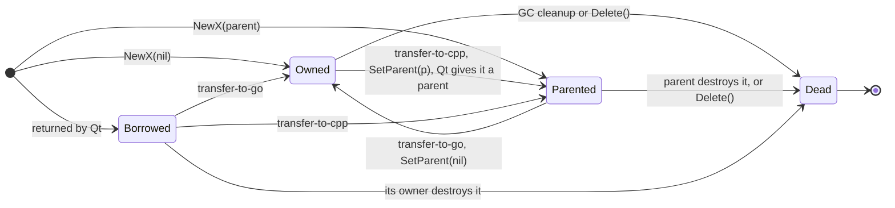
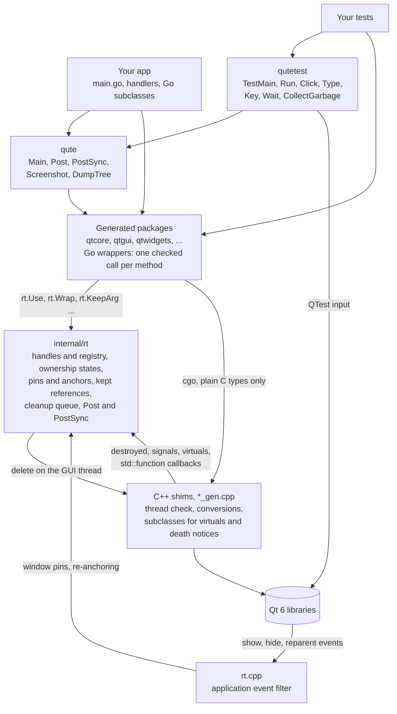
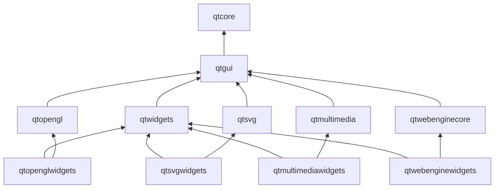
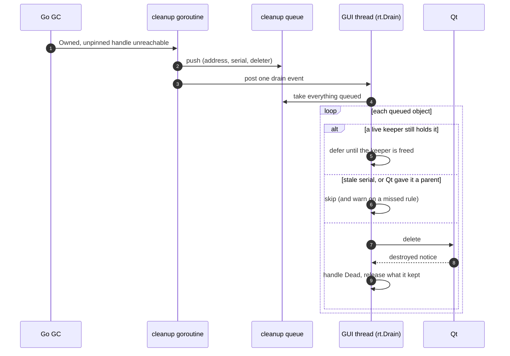
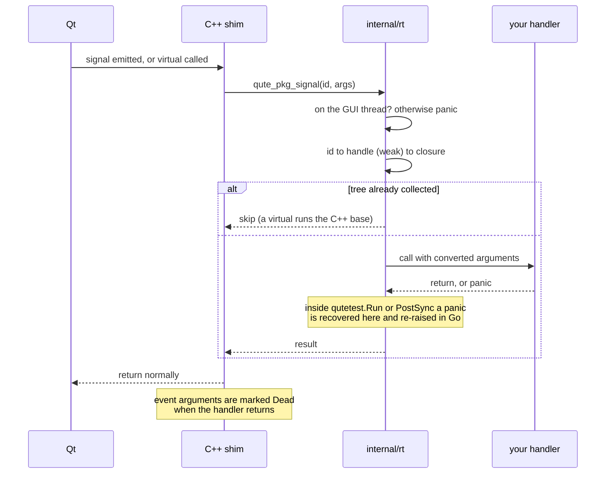
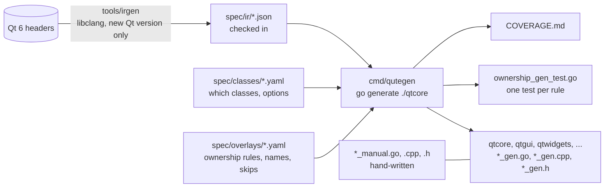

# qute

Qt 6 bindings for Go. Every Qt object has a Go handle that tracks who owns it,
so a double free or use-after-free is a clear panic instead of a segfault. GC
cleanup is on by default and safe, and `Delete()` is there when you need
cleanup to be deterministic. Apps can be built, tested, screenshotted and
inspected headlessly, which makes qute a good fit for desktop apps written
with a coding agent.

```go
package main

import (
	"os"

	"github.com/nomad-software/qute"
	"github.com/nomad-software/qute/qtwidgets"
)

func main() {
	os.Exit(qute.Main(func() {
		w := qtwidgets.NewQWidget(nil)                // Owned
		lay := qtwidgets.NewQVBoxLayout(w)            // Parented to w
		lbl := qtwidgets.NewQLabelWithText("hi", nil) // Owned
		lay.AddWidget(lbl)                            // lbl: Owned -> Parented
		w.Show()                                      // w pinned while visible
	}))
}
```

Requirements: Go 1.26+, Qt 6.12 or newer (development packages), `pkg-config`
and a C++17 compiler. The bindings are generated from Qt 6.12 and use its
API, so older Qt (Ubuntu 24.04 ships 6.4) fails to compile them. Linux is the supported platform for now. Each Go package
needs only its own Qt module, so an app that doesn't import `qtwebenginewidgets`
doesn't need Qt WebEngine installed (see [Qt modules](#qt-modules)). The first
build compiles the C++ shims, which takes about two minutes; after that Go's
build cache keeps rebuilds fast.

The API is not frozen yet. qute is tagged v1, but nobody depends on it yet,
and until that changes a minor version may rename or move things when that
makes the API clearer (as moving the test helpers to `qutetest` did). Pin an
exact version if you use it.

## Why qute

- **Mistakes panic and say what to do.** Calling a method on a widget whose
  parent has already freed it is the classic Qt crash. In qute it is a Go
  panic that names the method, what happened and the fix:
  `QLabel.SetText: object destroyed (destroyed by Qt); keep its owner alive
  while you use it, or check Alive() first`. Ownership mistakes don't corrupt
  memory.
- **Memory management that works like Go.** Objects you create are freed by
  the GC once they are unreachable. Objects handed to Qt (added to a layout,
  given a parent) are left for Qt to free. Visible windows are pinned, so the
  GC never frees something on screen. A window's signal handlers, Go
  subclasses and kept references are held by the window's own handle, so a
  closed window nobody refers to is freed with all of them, even when a
  handler mentions the window. Image and pixmap memory counts towards running
  the GC. `Delete()` is there when you want it.
- **Your Qt knowledge carries over.** Names follow the Qt docs (`setText` is
  `SetText`, `QLineEdit::Password` is `QLineEditPassword`), and every
  generated method's doc comment gives the C++ signature, its ownership rule
  and a link to the Qt page.
- **Idiomatic Go at the edges.** `QString` is `string`, `QList<T>` is a slice,
  `QPoint`/`QRect`/`QColor` are plain structs, out-parameters are extra
  results, failures return `error`, and `std::function` parameters take Go
  funcs.
- **Broad coverage.** About 550 classes across eleven Qt modules (widgets,
  OpenGL, SVG, multimedia and the web engine): over 12,000 constructors,
  methods and functions. Any class with virtuals can be subclassed from Go
  (about 240: widgets, views, delegates, validators, layouts, item models,
  graphics items, styles, syntax highlighters, undo commands, icon engines,
  gesture recognizers, wizard pages, `QOpenGLWidget`, web URL scheme handlers); `COVERAGE.md` lists the few Qt doesn't allow and why. A method with C++ default arguments has a short form and
  a `Full` form that takes them all (`Index(row, col)` and
  `IndexFull(row, col, parent)`).
- **Checked, not hoped.** Every ownership rule lives in a small YAML file
  and has a generated test (create, transfer, delete the owner, check the
  handle is Dead). They also run under AddressSanitizer and `cgocheck2`. `COVERAGE.md` lists every method left out and why.
- **Plain `go build`.** One cgo package per Qt module, found through
  `pkg-config`. You don't need a separate build system or code generation
  step in your app.

## Qt modules

Each bound Qt module is one Go package with its own cgo shim, found through
`pkg-config`. An app links only the modules it imports.

| Package               | Qt module           | What it covers                                                         | Arch package |
| --------------------- | ------------------- | ---------------------------------------------------------------------- | ------------ |
| `qtcore`              | QtCore              | objects, signals, timers, item models, files, settings, variants, URLs  | `qt6-base`   |
| `qtgui`               | QtGui               | painting, images, fonts, colours, text documents, windows, GL functions | `qt6-base`   |
| `qtwidgets`           | QtWidgets           | widgets, layouts, dialogs, item views, graphics view                   | `qt6-base`   |
| `qtopengl`            | QtOpenGL            | shader programs, buffers, VAOs, textures, framebuffer objects          | `qt6-base`   |
| `qtopenglwidgets`     | QtOpenGLWidgets     | `QOpenGLWidget`                                                        | `qt6-base`   |
| `qtsvg`               | QtSvg               | `QSvgRenderer` (draw SVG with a painter), `QSvgGenerator` (write SVG)  | `qt6-svg`    |
| `qtsvgwidgets`        | QtSvgWidgets        | `QSvgWidget`, `QGraphicsSvgItem`                                       | `qt6-svg`    |
| `qtmultimedia`        | QtMultimedia        | playback, capture (camera, screen, window), recording, audio in/out, video frames | `qt6-multimedia` (plus a backend, e.g. `qt6-multimedia-ffmpeg`) |
| `qtmultimediawidgets` | QtMultimediaWidgets | `QVideoWidget`, `QGraphicsVideoItem`                                   | `qt6-multimedia` |
| `qtwebenginecore`     | QtWebEngineCore     | pages, profiles, settings, history, scripts, downloads, URL scheme handlers, request interceptors | `qt6-webengine` |
| `qtwebenginewidgets`  | QtWebEngineWidgets  | `QWebEngineView`                                                       | `qt6-webengine` |

Ownership in the newer modules follows Qt's documented rules, like the rest:

- Qt Multimedia never owns what you plug into a player or capture session
  (audio outputs, video sinks and widgets, cameras, recorders, devices). Each
  setter keeps its argument alive while the receiver uses it, so
  `player.SetAudioOutput(qtmultimedia.NewQAudioOutput(nil))` is safe.
  `QVideoFrame` and `QAudioBuffer` count their pixel and sample bytes towards
  running the GC, like images do.
- Qt WebEngine requires a profile to outlive its pages. A page keeps its
  profile, and when the GC collects both together the page is freed first. A
  view keeps a page passed to `SetPage` without owning it. Chromium runs in
  helper processes; as root or in containers, set
  `QTWEBENGINE_DISABLE_SANDBOX=1`.
- `QGraphicsSvgItem.SetSharedRenderer` and `QSvgGenerator.SetOutputDevice`
  keep their arguments alive.

Within a bound module, a few methods are left out because they need a module
qute doesn't bind or a type it can't map yet: printing (`QWebEngineView.Print`), `QWebChannel`,
cookie objects, certificates and authentication (QtNetwork types), HTTP header maps
keyed by byte arrays, `std::optional<qreal>` frame-rate limits, custom video
buffers and web notifications (Qt hands a notification to its presenter as a
`std::unique_ptr`, so `QWebEngineNotification` is not bound). `COVERAGE.md` lists every one with its reason.
`QWebEngineCookieStore.SetCookieFilter` is hand-written: Qt calls the filter
on a network thread, so it gets plain Go values (`CookieFilterRequest`) and
must not touch Qt objects.

`QIODevice` can't be subclassed from Go, and a Go subclass of `QBuffer` or
`QFile` can't override `readData`, so there are no custom streams yet: no
pull-mode audio from a Go source, no custom media source and no streaming
replies from a URL scheme handler. Use a `QBuffer` or `QFile` instead. (Qt
Multimedia and the web engine read devices from their own threads, so a Go
device needs the same care as the cookie filter.)

Not bound yet:

- **QtQuick and QML**: Qml, Quick, QuickControls2, QuickWidgets, Quick3D,
  WebEngineQuick, MultimediaQuick and the Labs modules. A QML-first API is
  planned for later.
- **Other modules**: QtNetwork, QtPrintSupport, QtSql, QtXml, QtDBus,
  QtWebChannel, QtWebSockets, QtPdf and QtPdfWidgets, QtGraphs (charts),
  QtTextToSpeech, QtPositioning, QtLocation, QtBluetooth, QtNfc,
  QtSerialPort, QtSpatialAudio, QtHelp, QtUiTools, QtVirtualKeyboard and
  Qt5Compat. Go's standard library covers much of what some of them do
  (`net/http`, `database/sql`, `encoding/xml`).
- **Not planned**: QtConcurrent (templates; use goroutines and `qute.Post`),
  QtTest (the `qutetest` package wraps what tests need: `Click`, `Type`,
  `Key`, `Wait`), and tool or internal libraries (Designer, Linguist, QmlCompiler,
  ShaderTools, UiPlugin, platform plugins).

Adding a module is mostly spec work (see [How the bindings are made](#how-the-bindings-are-made)).

## Building apps with a coding agent

GUI code is hard for an agent to get right without seeing the result: it
can't watch the window, and with most C++ bindings a mistake is a segfault
with no clue where it came from. qute gives an agent the same loop it has for
any other Go code (write, run the tests, read the output, fix) and adds a way
to see the UI:

- **Everything runs headlessly.** Tests use Qt's offscreen platform, so
  `go test ./...` needs no display, no X server and no window manager. It
  works the same in a container, in CI or in an agent's sandbox.
- **The agent can look at the window.** `qute.Screenshot(w)` renders any
  widget to an `image.Image`, and `qute.SaveScreenshot(w, "out.png")` writes a
  PNG an agent can open and inspect. Layout bugs (clipped text, a widget the
  wrong size, a missing button) are visible without a person at the screen.
- **The agent can read the window.** `qute.DumpTree(w)` returns the object
  tree as JSON: class, `objectName`, ownership state, pins, what holds its Go
  state (`anchored`), geometry and visibility. It is a precise, text-only view of what is on screen.
- **The agent can use the window.** `qutetest.Click`, `ClickAt`,
  `DoubleClick`, `Type` (including non-ASCII text), `Key` and `Wait` drive
  real Qt input events through QTest, so behaviour tests exercise signals and
  handlers the way a user would. They live in their own package, so a
  program's binary doesn't link QtTest.
- **Errors explain themselves.** Panics name the method, say what happened,
  give the fix and, where an ownership rule applies, cite its number.
  `qutetest.Run` turns a panic into a test failure (with the Go stack for runtime
  errors) instead of crashing the test binary, including a panic in a signal
  or event handler, which is caught where Qt called it. An agent can act on the
  message alone. A Qt call from the wrong goroutine panics too. With
  `-tags qute_debug` the messages also give the call sites where the object
  was created and destroyed, and the thread check names the method.
- **Static checks catch the common mistakes.** `qute vet ./...` reports
  leaked Owned objects and Go subclasses, `Delete()` of a QObject inside a
  handler, Qt calls from a goroutine and event arguments kept past their callback.
- **A known-good starting point.** `qute new app <dir>` writes a window, a
  `main.go`, a behaviour test and a screenshot test that pass from the start.
- **The API is predictable.** Names map one-to-one from the Qt docs an agent
  already knows, and there is one obvious way to do each thing: redundant
  overloads are left out and the rest get descriptive names.

A typical loop looks like this:

```sh
qute new app ./myapp && cd myapp      # window, main.go, tests
go test ./...                          # behaviour + screenshot tests, headless
go test -run Screenshot -v .           # logs the PNG path and the object tree
qute vet ./...                         # ownership and threading checks
```

A test that both checks behaviour and leaves something to look at:

```go
func TestMain(m *testing.M) { qutetest.TestMain(m) } // offscreen QApplication

func TestClick(t *testing.T) {
	qutetest.Run(t, func() { // runs on the GUI thread
		w := NewWindow()
		defer w.Delete()
		qutetest.Click(w.Button)
		qutetest.Type(w.Name, "Ada")
		if got := w.Greeting.Text(); got != "Hello, Ada" {
			t.Errorf("greeting = %q", got)
		}
		qute.SaveScreenshot(w, filepath.Join(t.TempDir(), "window.png"))
		t.Log(qute.DumpTree(w)) // class, objectName, ownership, geometry as JSON
	})
}
```

For your own project's agent instructions (`CLAUDE.md`, `AGENTS.md`), these
lines are a good start:

```markdown
- GUI code uses qute (Qt 6 for Go). Run `go test ./...`; tests are headless.
- To check a layout, save a screenshot with qute.SaveScreenshot and open
  the PNG; use qute.DumpTree for exact geometry.
- Drive the UI in tests with qutetest.Click/Type/Key inside qutetest.Run.
- Run `qute vet ./...` before finishing. Inside handlers delete QObjects
  with DeleteLater, never Delete. From goroutines use qute.Post.
```

## Ownership

Each handle is in one state, changed only by annotated methods:

| State    | Who frees it                   | Example                           |
| -------- | ------------------------------ | --------------------------------- |
| Owned    | Go (GC cleanup or `Delete()`)  | `NewQWidget(nil)`                 |
| Parented | its Qt parent or container     | a widget after `lay.AddWidget(w)` |
| Borrowed | someone else; Go never frees   | `QApplicationFocusWidget()`       |
| Dead     | already destroyed              | any handle after its object died  |



A Dead handle stays valid Go memory; every method on it panics with what
happened and the fix.

- Using a Dead handle panics with the class, method and fix, and so does a
  Qt call off the GUI thread, and `Delete()` of a QObject inside a handler
  (use `DeleteLater()`). Build with `-tags qute_debug` to also get the
  creation and destruction call sites (the first frame of your own code,
  `main` included) and the method name in thread panics.
- `Delete()` also panics where Qt would be left with a dangling pointer: on
  an object something still uses without watching for its destruction (the
  image a `QPainter` draws on until `End()`, or while `PaintOn` runs; a stream's device), and on a
  layout item inside a layout (take it out with `TakeAt` first).
- GC never frees a window you can see: a visible top-level widget or
  `QWindow` is pinned, and so is anything after `Keep()` until `Unkeep()`.
  GC also never deletes a QObject that has a parent, even if an ownership rule
  was missed (it prints a warning naming the class), and an object Qt gives a
  parent becomes Parented, also when a method that hands an object to Go
  finds Qt has already parented it.
- Go state of an object (its signal handlers, its Go subclass value, the
  references it keeps) lives as long as the object. Inside a window it is
  held by the window's handle, so GC frees an unreachable, hidden window with
  everything in it. A parentless object with its own signal connections, or a
  parentless Go subclass, holds itself: `Delete()` it when done (`qute vet`
  flags ones that never are).
- A widget added to a layout that never gets a widget, and is then dropped,
  goes back to Go and is freed.
- GC cleanups never run `delete` on a GC goroutine. They queue onto the GUI
  thread, and after the event loop exits, queued cleanups are dropped.
- Every call keeps its receiver and arguments alive until it returns, so GC
  can't free them during a call that runs a nested event loop.
- When Qt keeps a pointer it doesn't own (a view's model, a stream's device,
  a button's menu, actions added to a menu), the receiver holds a reference to
  it, so GC can't free it while Qt still uses it. A `QModelIndex` keeps its
  model alive (a `QTextBlock` or `QTextTableCell` its document, a `QWidgetItem`
  its widget), and using one after that owner was deleted panics. The same
  holds for a plain object a method hands out, such as a layout's item or a
  painter's device: it is only valid while that receiver lives.
- A QObject seen through another base class (a `QGraphicsTextItem` among a
  scene's `QGraphicsItem`s, a widget as a `QPaintDevice`) shares the object's
  handle and its state.
- What a Go override returns to a C++ caller that owns it (`MimeData`,
  `CreatePopupMenu`) becomes Parented, so GC leaves it to Qt.
- Images, pixmaps and pictures count their bytes; once enough are allocated
  qute runs the GC, and inside a handler frees the dropped ones right away.
- `Ownership()`, `Alive()`, `Delete()`, `Keep()`, `Unkeep()` and `Ptr()` exist
  on every object. `XFromPtr(p, qtcore.Borrowed)` is the unsafe escape hatch.

## API conventions

| Qt C++                                   | Go                                          |
| ---------------------------------------- | ------------------------------------------- |
| `new QLabel(parent)`                     | `qtwidgets.NewQLabel(parent)`               |
| `new QLabel("hi", parent)`               | `qtwidgets.NewQLabelWithText("hi", parent)` |
| `label->setText(s)`                      | `label.SetText(s)`                          |
| `QApplication::focusWidget()`            | `qtwidgets.QApplicationFocusWidget()`       |
| `connect(btn, &QPushButton::clicked, …)` | `btn.OnClicked(func(checked bool) { … })`   |
| `emit model->dataChanged(a, b)`          | `model.EmitDataChanged(a, b)`               |
| `Qt::AlignLeft \| Qt::AlignTop`          | `qtcore.AlignLeft \| qtcore.AlignTop`       |
| `QLineEdit::Password`                    | `qtwidgets.QLineEditPassword`               |
| `qobject_cast<QLabel*>(obj)`             | `qtwidgets.QLabelCast(obj)`                 |

- Trailing default arguments are dropped; a constructor's `parent` is kept.
  Pass `nil` for "no parent". The method's `Full` form takes every argument:
  `lay.AddWidgetFull(w, 1, qtcore.AlignTop)`,
  `c.MovePositionFull(qtgui.QTextCursorRight, qtgui.QTextCursorKeepAnchor, 5)`.
  A defaulted out-parameter is a result of the `Full` form:
  `n, ok := loc.ToIntFull(s)`, `name, ok := qtwidgets.QInputDialogGetTextFull(nil,
  "Password", "Password:", qtwidgets.QLineEditPassword, "", 0, 0)`.
- Overloads get descriptive names: the one with the fewest parameters gets
  the plain name and the others a suffix for what differs (`Year` /
  `YearWithCalendar`, `DrawRect` / `DrawRectF`).
- An argument of type `QWidgetLike` accepts any widget (`*QLabel`,
  `*QPushButton`, your own subclass). Pass untyped `nil`, not a typed nil.
- `QString`, `QByteArray` and `QStringList` are `string`, `[]byte` and
  `[]string`. `QPoint`, `QSize`, `QRect`, `QMargins` and `QColor` are plain
  Go structs. `QImage`, `QFont`, `QIcon`, `QVariant` and other value classes
  are Owned handles that GC frees; a `QModelIndex` is kept in Go memory, so
  the index Qt hands a model's overrides for every row costs no C++ copy or
  cleanup. `qtcore.NewQVariantOf(v)` and
  `(*QVariant).Value()` convert to and from Go values; `qtgui.NewQVariantOf`
  and `qtgui.VariantValue` also take and return colours, icons, fonts, brushes,
  pixmaps, images and the other GUI values, for item model roles.
- Calls whose Qt result signals failure return `error`, e.g.
  `img.Load(path)`.
- Out-parameters become results: `l, t, r, b := layout.GetContentsMargins()`.
  A pointer and its count become one slice (`f.Read(buf)`), `QMap`/`QHash`
  become Go maps, `std::chrono` durations and times become `time.Duration` and
  `time.Time`, `std::filesystem::path` is a `string`, and `std::function`
  parameters take a Go func (`nil` for none).
- Events can be built and sent like any object:
  `qtcore.QCoreApplicationSendEvent(w, qtgui.NewQKeyEvent(qtcore.QEventKeyPress, int(qtcore.Key_A), qtcore.NoModifier))`.
  A sent event stays yours; a posted one (`QCoreApplicationPostEvent`) is
  Qt's, and its handle is Dead once Qt has delivered and deleted it.
- Methods that return the object itself chain: `t.Translate(10, 20).Rotate(45)`.
- Public data members get getters and setters (`opt.Rect()`, `opt.SetRect(r)`),
  and nested classes get flat names (`QFont::Tag` is `qtgui.QFontTag`).

## Signals, subclassing, threads

```go
conn := btn.OnClicked(func(checked bool) { ... })
conn.Disconnect() // optional; the connection also ends when btn dies

type Canvas struct{ qtwidgets.QWidgetBase }

func (c *Canvas) PaintEvent(e *qtgui.QPaintEvent) {
	qtgui.PaintOn(c, func(p *qtgui.QPainter) {
		p.FillRect(e.Rect(), qtgui.RGB(200, 30, 30))
	})
}

qtwidgets.NewQWidgetWith(&Canvas{}, nil)
```

Event arguments are scoped: they are Dead once the handler returns, so copy
out the values you need. `qtgui.PaintOn(device, f)` gives `f` a painter
that is scoped the same way: it is ended and freed when `f` returns, which
costs less than `NewQPainterOn` with `End()` and `Delete()` (keep that for
a painter that outlives one call). A helper you build on one and leave alive (a
`QPainterStateGuard` on a delegate's painter) is deleted when the handler
returns, as it would be at the end of its C++ scope. Call `c.Super().PaintEvent(e)` for the base
implementation. Models work the same way: embed
`qtcore.QAbstractListModelBase` and define `RowCount` and `Data`.

Every class with virtuals works like this, with no opt-in: embed
`<Class>Base`, define the virtuals you want, build it with
`New<Class>With(v, ...)`; every other constructor has a subclass form too,
its name plus `With` (`qtwebenginecore.NewQWebEnginePageWithProfileWith(v,
profile, parent)` makes a Go page in a profile of your own). Abstract classes (`QGraphicsItem`, `QLayout`,
`QValidator`, `QSyntaxHighlighter`) are built only that way, and a pure
virtual you don't define returns its zero value (the one exception is
`QIconEngine.Clone`, which Qt needs: the constructor panics without it).
Overrides only reach objects built this way: a widget made with plain
`New<Class>` (or by Qt, like a dialog's buttons) can't gain them later, so
build the Go type with `New…With` from the start, or watch an existing object
with an event filter (a Go `QObject` that overrides `EventFilter`, passed to
`InstallEventFilter`). An override has the same
Go signature as the method's binding, so in-out parameters are a parameter
plus a result:

```go
type upper struct{ qtgui.QValidatorBase }

func (u *upper) Validate(input string, pos int) (qtgui.QValidatorState, string, int) {
	return qtgui.QValidatorAcceptable, strings.ToUpper(input), pos
}

u := &upper{}
qtgui.NewQValidatorWith(u, edit)
edit.SetValidator(u)
```

Overrides are found through embedding, so a type that embeds your `Canvas`
inherits its `PaintEvent`.

The Base type also carries the class's protected methods (`SetFormat` on a
syntax highlighter, `SetState` on a view). `GoValue()` finds your Go value
behind a pointer Qt hands back: `view.ItemDelegate().GoValue().(*MyDelegate)`,
or the Go state you stored on a text block with `QTextBlock.SetUserData`.
`COVERAGE.md` lists the classes Go can't subclass (singletons only Qt
creates, `QIODevice`) and the few virtuals Go can't override, with reasons.

All Qt calls happen on the GUI thread (the main goroutine inside
`qute.Main`); a call from another goroutine panics. From other goroutines use
`qute.Post(f)` or `qute.PostSync(f)`. A panic in a handler that `f` triggers
is re-raised by `PostSync` with the handler's stack.

In tests, `t.Fatal` and `t.Skip` work inside `qutetest.Run` and end the test
as usual. A test may close or delete its windows: under `qutetest.TestMain`
closing the last window does not quit the application, as it does under
`qute.Main`.

The application object is never destroyed: once the event loop exits, qute
drops the cleanups still queued instead of running them, because deleting
objects after the application is gone crashes Qt. So no Qt destructor runs at
exit. Anything that relies on teardown, such as a web engine profile flushing
its storage or temporary files a Qt object would remove, should be deleted
explicitly while the event loop still runs: `Delete()` it before calling
`qute.Quit`, or `DeleteLater()` it from a handler.

## OpenGL

`QOpenGLWidget` is subclassed the same way. GL calls go through the context's
function table, with the `GL_*` constants in `qtgui`. The helpers
(`QOpenGLShaderProgram`, `QOpenGLBuffer`, `QOpenGLVertexArrayObject`,
`QOpenGLTexture`, framebuffer objects) are in `qtopengl`:

```go
type Canvas struct{ qtopenglwidgets.QOpenGLWidgetBase }

func (c *Canvas) InitializeGL() { /* build shaders and buffers */ }

func (c *Canvas) PaintGL() {
	gl := c.Context().Functions()
	gl.GlClearColor(0, 0.5, 1, 1)
	gl.GlClear(qtgui.GL_COLOR_BUFFER_BIT)
}

w := qtopenglwidgets.NewQOpenGLWidgetWith(&Canvas{}, nil)
img := w.GrabFramebuffer() // works headlessly with the offscreen platform
```

GL pointer arguments (`glBufferData`, `glGenBuffers`, …) are `unsafe.Pointer`,
because GL decides from other arguments how much memory it reads or writes;
keep that memory alive for the call. Uniforms use the location-based setters:
`p.SetUniformMatrix4x4(p.UniformLocation("mvp"), m)`. `opengl_test.go` draws
a triangle with a shader program, a vertex buffer and a VAO.

## The qute command

`go install github.com/nomad-software/qute/cmd/qute@latest`

- `qute new app <dir> [module]` writes `main.go`, a window, a behaviour test
  and a screenshot test.
- `qute vet ./...` reports Owned objects with connections, and parentless Go
  subclasses, that are never deleted or parented, `Delete()` of a QObject
  inside handlers and overrides (a painter, image or other non-QObject made
  in a handler is deleted there), Qt calls (including `qute.Screenshot` and the `qutetest`
  input helpers) from goroutines, and event, painter and style-option
  arguments (also `PaintOn`'s painter) stored past their callback.

Try the example: `go run ./examples/hello`, or render it headlessly with
`go run ./examples/hello -screenshot out.png -tree`.

## Architecture

qute has two halves: a generator that turns Qt's headers and a few YAML files
into Go packages, and a small runtime that every generated call goes through.
At run time an app talks to the generated packages, which call Qt through a
C++ shim; the shim calls back into Go when Qt destroys an object, emits a
signal or runs an overridden virtual. Only the runtime (`internal/rt`)
decides who frees what.



Each Qt module is one Go package with its own cgo shim, built through
`pkg-config`. A package may only use the modules it depends on, so an app
links exactly the Qt modules it imports:



### Freeing objects: the GC and the GUI thread

Qt objects may only be deleted on the GUI thread, but Go runs cleanups on a
goroutine of its own. So a cleanup never deletes anything: it queues the
object, and the GUI thread frees it from a posted event. Before deleting, the
runtime checks that the object is still the one the handle knew (addresses
get reused), that Qt hasn't given it a parent since, and that nothing still
keeps it (a page's profile waits for the page).



Images and other memory-heavy values also count their bytes outside the Go
heap. Enough of them run the GC, and on the GUI thread the values already
queued are freed at once, so a loop inside one handler stays bounded.

### Calling back into Go

A C++ lambda or shim subclass never holds a Go pointer, only an id. The id
refers to the sender's handle weakly; the Go closure lives on that handle,
which the root of its object tree holds. So a window nobody refers to is
collected together with its handlers, even when a handler mentions the
window.



## How the bindings are made



- `tools/irgen/irgen.py` parses the Qt headers into the IR. The IR is
  checked in, so the generator runs without Qt or libclang.
- `spec/classes/<module>.yaml` picks the classes and their options (`kind:
  value|event`, `notify-dtor`, `subclass: false`, ...). Classes with
  virtuals are subclassable unless the spec says otherwise.
- `spec/overlays/<module>.yaml` holds the ownership rules per method, using
  PyQt's vocabulary:

  ```yaml
  QLayout:
    addWidget:  { args: { w: transfer-to-cpp } }
    takeAt:     { return: transfer-to-go }
  QPainter:
    drawLines(const QList<QLineF>&): { name: DrawLineSegmentsF }
  ```

  The defaults follow Shiboken: a constructor argument named `parent` is
  `transfer-this`, other object pointers are `borrowed`, and value results
  are Owned copies. `keep` marks a pointer Qt stores without owning, and
  `out`/`in-out` confirm out-parameters, which are otherwise only a guess
  from the type and stay open in `COVERAGE.md`.
- `go generate ./qtcore` regenerates everything. Hand-written `*_manual.*`
  files are never overwritten.
- `COVERAGE.md` records what is bound, every method skipped on purpose with
  its reason, and anything still open. A summary table at the top shows the
  counts.
- A wrong rule is usually a one-line YAML fix plus its generated test.

## Repository layout

| Path                 | What                                                       |
| -------------------- | ---------------------------------------------------------- |
| `.` (package `qute`) | `Main`, `Post`, `Screenshot`, `DumpTree`, `ProcessEvents`    |
| `qutetest`           | `TestMain`, `Run`, `Click`, `Type`, `Key`, `Wait`, GC checks |
| `internal/rt`        | runtime: handles, registry, pins, cleanup queue, threads   |
| `qtcore`, `qtgui`, `qtwidgets`, `qtopengl`, `qtopenglwidgets`, `qtsvg`, `qtsvgwidgets`, `qtmultimedia`, `qtmultimediawidgets`, `qtwebenginecore`, `qtwebenginewidgets` | generated packages (plus `*_manual` files) |
| `cmd/qutegen`        | the generator                                              |
| `cmd/qute`           | `qute vet`, `qute new app`                                 |
| `spec`               | IR, class lists, ownership overlays                        |
| `examples/hello`     | a small app                                                |

## Development

```sh
go test ./...                          # everything, headless (offscreen)
go test -tags qute_debug ./...         # with call sites and method names in thread panics
LSAN_OPTIONS=suppressions=$PWD/lsan.supp go test -asan . ./qtcore ./qtgui ./qtwidgets ./qtopengl ./qtopenglwidgets ./qtsvg ./qtsvgwidgets ./qtmultimedia ./qtmultimediawidgets ./qtwebenginecore ./qtwebenginewidgets ./qutetest
GOEXPERIMENT=cgocheck2 go test . ./qtcore ./qtgui ./qtwidgets ./qtopengl ./qtopenglwidgets ./qtsvg ./qtsvgwidgets ./qtmultimedia ./qtmultimediawidgets ./qtwebenginecore ./qtwebenginewidgets ./qutetest
go generate ./qtcore                   # regenerate packages, tests, COVERAGE.md
staticcheck ./...                      # optional lint; staticcheck.conf allows `this` receivers
python3 tools/irgen/irgen.py           # re-parse headers (new Qt version only; needs python3-clang)
```

`lsan.supp` silences memory that GL and video drivers, FFmpeg and Chromium
(Qt WebEngine's internals) keep until exit. It lists only those libraries, so
qute's own allocations are still checked. On a machine with CUDA, also set
`QT_FFMPEG_DECODING_HW_DEVICE_TYPES=, QT_FFMPEG_ENCODING_HW_DEVICE_TYPES=,`
for `-asan` runs (see the comment in `lsan.supp`). `go test ./...` needs
every module's Qt package installed (`qt6-svg`, `qt6-multimedia`,
`qt6-webengine`); as root or in a container, set
`QTWEBENGINE_DISABLE_SANDBOX=1`.

To fix a binding, edit `spec/overlays/<module>.yaml`, run `go generate
./qtcore`, then run that module's tests. To bind a new class, add it to
`spec/classes/<module>.yaml` (its primary base must be bound too).

## Status

The runtime, the bindings for the eleven modules above and Go subclassing are
done. No method is waiting for type support, every ownership rule has been
reviewed, every overload has a proper name, every out-parameter is confirmed
by a rule, and every rule but `QEvent::clone`,
`QWebEngineUrlRequestJob::reply`, `QSyntaxHighlighter::setCurrentBlockUserData`,
`QIconEngine::clone` and `QGestureRecognizer::create` has a generated test
(about 720 in all; the last four are covered by hand-written tests, since a
job exists only while Qt loads a URL, the user data only matters inside
`highlightBlock`, and the two abstract classes need a Go override).

Not done yet:

- About 840 methods are skipped on purpose, each with its reason in
  `COVERAGE.md`: C++ move overloads, `QBindable`, iterators, Qt's private
  and platform internals, `QStringView` and plain-number twins, printing page
  setup, accessibility, Vulkan and types from modules that aren't bound. About 620 operators, conversion
  operators and member templates are not in the IR at all; `COVERAGE.md`
  lists them too.
- `QThread` affinity, QtQuick/QML and the other modules listed under
  [Qt modules](#qt-modules).
- Doc comments link to the Qt docs but don't include Qt's summary text.
- Linux comes first for now; macOS and Windows support comes later.

## Licence

qute is licensed under the GNU General Public License v3.0; see `LICENSE`.
